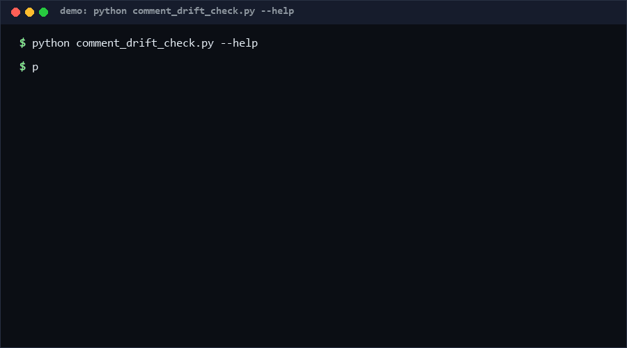

# comment-drift-check

Flags comments that drifted from code: docstring-documented parameters that no longer exist, documented return names the function never returns, and documented exceptions the function never raises — plus the inverse (undocumented params and raises). Pure `ast`, deterministic, offline.

<p align="center"></p>

## Problem

Docstrings rot silently. A signature gains a parameter; the docstring keeps describing the old world. Six months later a maintainer reads the docstring, trusts it, and writes a bug. Existing linters check docstring *style* (format, coverage) but almost none check docstring *truth* against what the function actually does — and none do it as a diffable, rule-numbered report.

## How it works

For every function with a docstring, the checker extracts declarations (reST `:param x:` / `:returns: name` / `:raises X:`, and Google `Args:` / `Returns:` / `Raises:` blocks) and compares them with AST reality:

| Rule | Severity | Meaning |
|---|---|---|
| CD001 | medium | docstring documents a parameter the signature lacks |
| CD002 | info | signature parameter missing from docstring |
| CD003 | medium | documented return name never appears in a `return <name>` |
| CD004 | info | code raises an exception the docstring omits |
| CD005 | medium | docstring documents a raise the code never performs |

Findings carry file, function, line, rule, severity, message; the CLI exits 1 when anything is found, so it can gate PRs.

## Quickstart

```bash
# Check one file (~0.1s [estimated, repro: time python comment_drift_check.py check m.py])
python comment_drift_check.py check mymodule.py

# Check a tree, JSON output for tooling
python comment_drift_check.py check src/ --format json

# Full self-test, 50 checks (~0.2s [estimated, repro: time python self_test.py])
python self_test.py
```

## How this differs (why-not-X)

| Alternative | Stars* | How this repo differs |
|---|---|---|
| [mbork/find-stale-comments](https://github.com/mbork/find-stale-comments) | 0 | A pre-commit script that blocks edits touching code without touching its comment; this is a whole-tree rule engine comparing docstring claims (params/returns/raises) against the AST, not an edit-time guard. |
| [farisabujolban/stale-comment-guard](https://github.com/farisabujolban/stale-comment-guard) | 0 | Guard-oriented stale-comment watcher; this computes concrete drift findings from docstring structure and is language-docstring-style aware (reST + Google). |
| `pydocstyle` (PyPI) | adjacent | Validates docstring formatting conventions (sections, capitalization); this validates semantic consistency between docstring and behavior, which style tools ignore. |

\* Stars from the R13 precheck snapshot, as of 2026-10-11.

## Minimal Fallback

Without this tool, review time: in PR diff view, require that any hunk touching a `def` line also shows the docstring — and grep the docstring's params against the signature by eye: `grep -n ":param\|Args:" mymodule.py`. Crude, manual, but catches the worst ghost-params on small files.

## Design Trade-offs

- **Structural claims only** — params/returns/raises are checkable; prose claims ("this is fast") are out of scope by design.
- **Name-based return checking** — only `return <name>` verifies a declared return name; `return compute()` or tuple returns count as mismatch. Strict, low-noise, occasionally pedantic.
- **Both directions reported** — undocumented items (CD002/CD004) are `info` so strict-docstring teams can gate on everything while others filter.
- **Python-only** — AST-based; other languages need per-language grammars.

## Limits & Second-order Effects

- A function with no docstring is skipped entirely: the tool cannot invent claims to verify (by design), so it biases toward *documented* code.
- Conditional raises (`if os.name == "nt": raise ...`) are matched regardless of platform — findings may not apply to your platform.
- Second-order: teams may start writing boilerplate docstrings just to satisfy the checker, degrading signal; gate on CD001/CD003/CD005 (real drift) and treat CD002/CD004 as advisory.
- Decorated wrappers (`functools.wraps`) can copy a stale docstring onto a new signature; findings point at the wrapper, not the original.

## FAQ

**Does it execute code?** Never. Parse-only via `ast`.

**Which docstring styles?** reST (`:param:`) and Google (`Args:`); NumPy style is not parsed in v0.1.

**Why is my correct docstring flagged CD003?** The rule matches literal `return <name>` statements; if you return an expression, assign it to the declared name first or drop the name from `:returns:`.

**When NOT to use this?** Do not use it on codebases whose docstrings are intentionally aspirational or template-generated; do not gate CI on `info`-level rules on a legacy codebase (wall of findings → tool gets disabled); skip it for modules where docstrings are prose essays without structural claims — there is nothing mechanical to verify.

## [Core Assumptions]

1. Docstrings that make structural claims (params/returns/raises) should match the code, always.
2. reST and Google styles cover the large majority of Python docstrings in practice.
3. `return <name>` is the intended signal for "returns X"; expression returns are treated as unnameable.
4. Findings are advisory review aids; severity levels encode trust, not certainty.

---

*Confidence: medium-high — rule mechanics are deterministic and fully self-tested; docstring parsing is heuristic for nonstandard styles. Content as of 2026-10-11.*

---

Part of the [zhengming-toolbox](https://github.com/chenhz01/zhengming-toolbox) — 55 purpose-built AI-engineering tools across neglected niches.

Related tools: [deprecated-api-scan](https://github.com/chenhz01/deprecated-api-scan) · [doc-rot-detector](https://github.com/chenhz01/doc-rot-detector) · [readme-quality-score](https://github.com/chenhz01/readme-quality-score)
